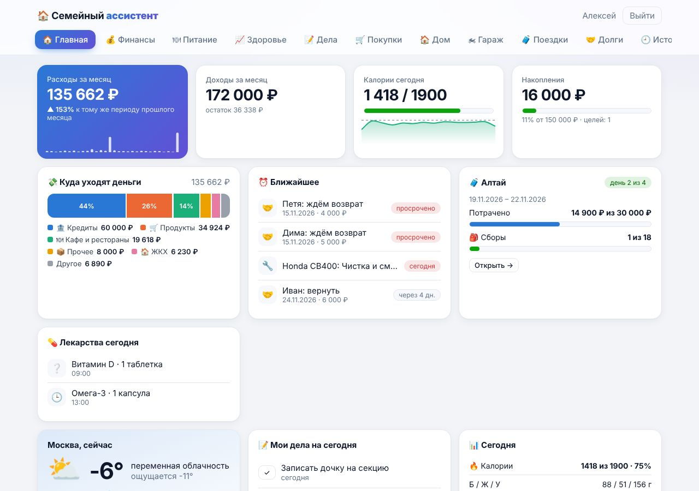
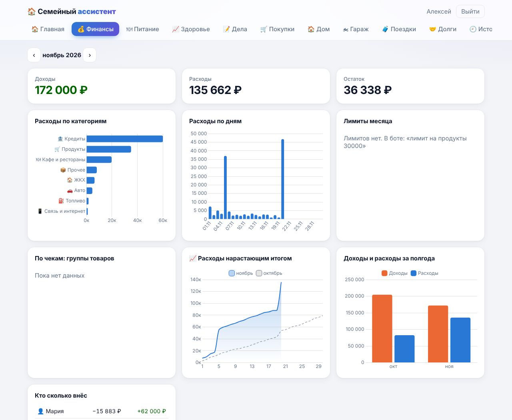
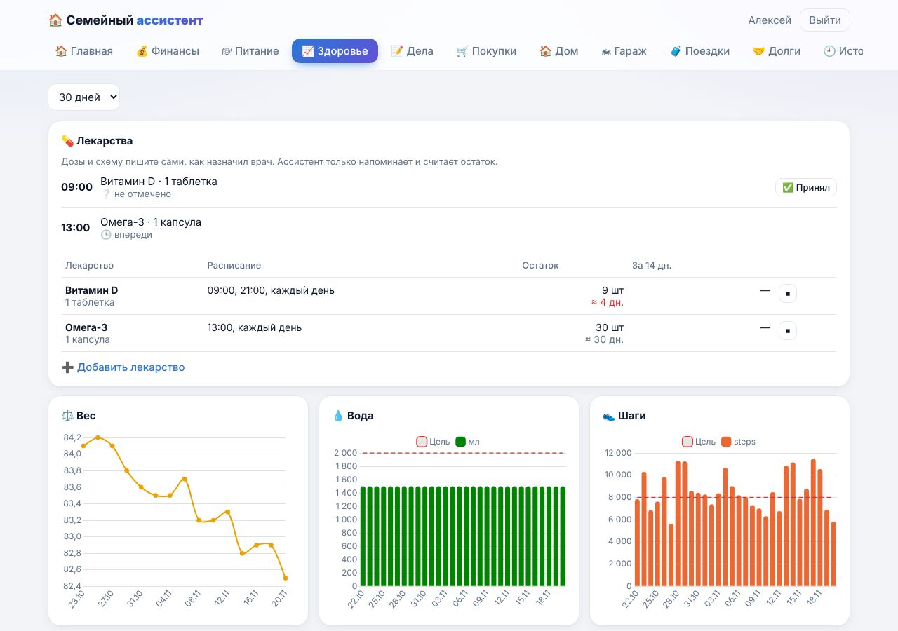
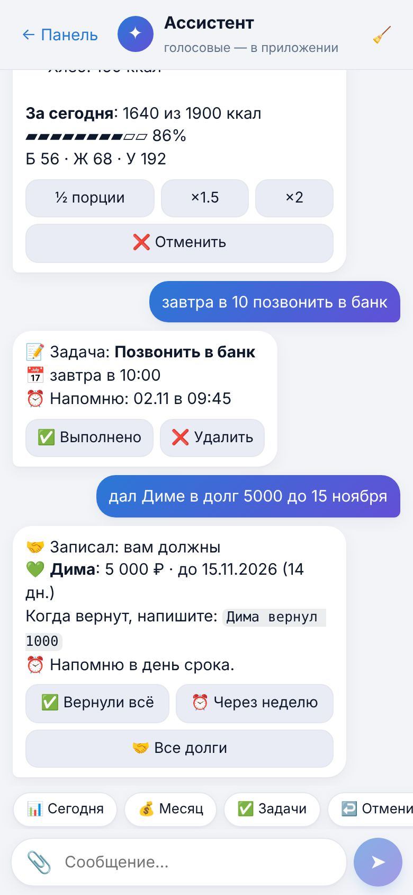
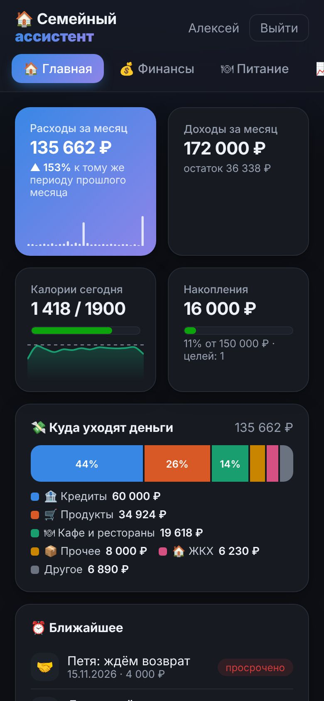

# Семейный ассистент

**Система, которая ведёт домашнее хозяйство одной фразой.** Telegram-бот, голос, Яндекс Алиса и веб-панель: траты, питание, дела, лекарства, счётчики, гараж, поездки и долги — без форм, таблиц и выбора категорий.

Личный проект, который работает каждый день в реальной семье с октября 2026. Не демо и не SaaS: здесь проверяются инженерные решения, которые потом переносятся в бизнес-задачи.

[Сайт](https://assistant.saidov.ru) · [Демо-панель](https://demo.assistant.saidov.ru) · [Telegram-канал о проекте](https://t.me/bez_ruchnoy_raboty)

---

## Как выглядит

Скриншоты демо-кабинета, данные вымышленные.

<p>
  
  
</p>
<p>
  
  
  
</p>

---

## Что умеет

- **Запись одной фразой.** «Пятёрочка 1450 продукты» → трата 1 450 ₽, категория «Продукты», привязка к магазину. Категорию и дату система определяет сама.
- **Пять каналов ввода.** Telegram-бот, голосовые, Яндекс Алиса, веб-панель, ярлык-приложение (PWA).
- **Фото чека и тарелки.** Позиции чека раскладываются по группам товаров, КБЖУ оценивается по фото.
- **Планирование.** Дела с напоминаниями, двусторонняя синхронизация с TickTick, утренняя сводка в 7:30, недельный разбор по воскресеньям.
- **Деньги.** Лимиты по категориям, накопления, долги, курсы, индексы, ключевая ставка.
- **Хозяйство.** Счётчики, документы, ТО мотоцикла, режим поездки, лекарства, привычки, карты лояльности.
- **Отмена любой операции.** Кнопка «Отменить», возврат отменённого, фраза «отмени последнюю трату».
- **Веб-панель.** Графики, история, чат с ассистентом, вход по одноразовой ссылке из бота.
- **Приложение без магазинов.** Панель ставится ярлыком на Android, iPhone и рабочий стол, с push-уведомлениями.
- **Демо-кабинет.** Отдельный контейнер с вымышленной семьёй: можно потрогать панель, не трогая реальные данные.

---

## Как устроено

```
Telegram ─┐
Алиса ────┼──► адаптеры ──► ядро ──► PostgreSQL ──► бэкапы (ночь)
Веб ──────┘                 │
                            ├──► Claude Haiku (текст, чеки, фото)
                            ├──► Whisper (голос → текст)
                            ├──► TickTick (задачи, двусторонняя синхронизация)
                            └──► n8n (события и внешние сценарии)
```

| Контейнер | Ответственность |
|---|---|
| `core` | Вся логика: разбор сообщений, расчёты, напоминания, API для n8n и панели |
| `telegram` | Приём сообщений из Telegram и показ ответов |
| `db` | PostgreSQL, данные на своём сервере |
| `backup` | Ночные копии: 7 дневных, 4 недельных, 6 месячных |

Ядро не публикуется наружу: снаружи через Caddy доступны только вход в панель, health-check и вебхуки. Адаптеров может быть сколько угодно: новый канал добавляется рядом с `telegram`, ядро и данные не меняются.

### Инженерные решения, которые стоит отметить

- **LLM — парсер, а не источник истины.** Модель разбирает фразу в структуру, но все расчёты, лимиты и отчёты считает код. Если модель ошибается — запись можно отменить, данные не «уплывают».
- **Отмена как принцип.** У каждой записи есть обратная операция и история. Это дешевле любой фичи и важнее половины из них.
- **Идемпотентность.** Повторное сообщение не создаёт дубль; события для n8n уходят с идентификатором.
- **Свой сервер и копии.** Данные не у третьих лиц; восстановление проверяется, а не предполагается.
- **Обновление по кнопке.** Агент на хосте забирает стабильную ветку, делает копию базы, пересобирает контейнеры и откатывается при ошибке.

---

## Стек

Python · PostgreSQL · Docker Compose · Claude Haiku (текст и изображения) · Whisper на Groq (голос) · PWA · Caddy · n8n

Тесты — `tests/run_all.sh`, проверки в GitHub Actions на каждый push. Версия — в файле `VERSION`, что нового — в `core/CHANGELOG.md`.

---

## Быстрый старт

Нужен сервер с Docker и 2 ГБ памяти.

```bash
git clone https://github.com/aasaidov38/assistant.git
cd assistant
cp .env.example .env      # заполнить токен бота и ключ модели
bash scripts/setup.sh
docker compose up -d --build
bash scripts/check.sh
```

Дальше — написать боту `Пятёрочка 1450 продукты`.

**Полная инструкция по установке, настройке, Алисе, TickTick, n8n, бэкапам и обновлению — в [docs/INSTALL.md](docs/INSTALL.md).**

---

## Структура репозитория

```
adapters/       приём сообщений из разных каналов
core/           ядро: логика, БД, API, панель, промпты, тесты
docs/           архитектура, установка, демо, релизы
scripts/        setup, проверки, бэкапы, агент обновления
site-src/       исходники сайта проекта
tests/          интеграционные проверки
docker-compose.yml
```

Архитектура подробнее — [docs/ARCHITECTURE.md](docs/ARCHITECTURE.md).

---

## Ограничения

- Один сервер, одна семья. Многотенантности нет и не планируется.
- Интерфейс на русском; мультиязычность в планах.
- Часть интеграций (Алиса, TickTick, n8n) требует внешних ключей и настраивается вручную.
- Оценка КБЖУ по фото приблизительная, обычно ±20–30%.

---

## Планы

- Мультиязычный интерфейс.
- Почта как ещё один канал ввода (1.11).
- Версия 2.0: пересборка навигации и сценариев.

Дорожная карта — на [сайте проекта](https://assistant.saidov.ru/roadmap.html).

---

## Лицензия

MIT. Берите, разбирайте, используйте как основу для своих проектов. Секреты в репозиторий не попадают: `.env`, `backups/` и `state/` в `.gitignore`.

---

## Контакты

Александр Саидов · [assistant.saidov.ru](https://assistant.saidov.ru) · Telegram: [@bez_ruchnoy_raboty](https://t.me/bez_ruchnoy_raboty)
